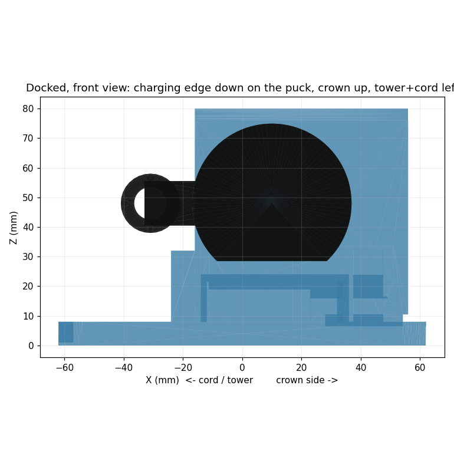

# Muse Watch — Pixel Watch 4 ペンダント & ドッキングステーション

**Web 3D ビューワー: https://goroman.github.io/muse-watch/** (パーツ切替・回転・ズーム・組立表示)

Google Pixel Watch 4 (45mm) をネックレスのペンダントとして身に着け、
**ネックレスを付けたまま** PalmPilot のクレードルのように上から差し込んで
充電できるドックの 3D プリントモデル。

## 仕組み

Pixel Watch 4 の充電接点は背面ではなく**左側面**にある（スピーカーの両脇の2ピン）。
純正 Quick Charge Dock パックは 41 × 27 × 9.6 mm（Google 公式スペック）で、
時計の左側面がパック上面の溝にはまる。

そこで:

1. **ペンダントシェル v4** — 既存の実機スキャン基準シェル (v3) の左側を
   弦で切り落として開口にした (切断面 x = -19.5 mm)。時計の左側面が
   シェルから 3.1 mm 突き出す。
2. **ドック** — ペンダントを正面から見て 90° 反時計回りに回した姿勢
   （充電側面＝下、竜頭＝上、タワーと紐＝左）で上から落とし込む。
   - 下: 純正パックを収めたサドル。シェルの切断面がパック上面に当たり
     ストッパーになり、突き出した時計側面がパックの溝に 3.1 mm 入る。
     自重 + パックのマグネットで接点が合う。
   - 左: 紐の通り道は開放 (コードベイ)。タワーとベイルがドックの外に
     出るので、紐を外さず・絡めずに置ける。ベース左端に紐の逃げノッチ。
   - 背面: 壁 + 前面下部に低いリップがあり、前後に倒れない。
   - パックのケーブルはサドル右端のトンネル → ベース上面の溝を通って
     背面側へ抜ける。
3. 竜頭が上を向くので、ドックに置いたまま竜頭・サイドボタンの操作と
   画面確認ができる (置き時計モードそのまま)。

## パーツ

| ファイル | 素材 | 説明 |
|---|---|---|
| `models/pendant_shell_v4.stl` | PLA | ペンダントシェル v4 (充電側開口) |
| `models/pendant_liner_v3.stl` | TPU | 内側ライナー (v3 から継続) |
| `models/pendant_bail_v3.stl` | TPU | 吊り輪ベイル (v3 から継続)。紐は使用者側で用意 |
| `models/pendant_side_module_v3.stl` | TPU | 竜頭/ボタン押しモジュール (v3 から継続) |
| `models/dock.stl` | PLA | ドッキングステーション本体 (124 × 92 × 80 mm) |
| `models/puck_fit_test.stl` | PLA | パックポケットだけのフィット確認用テストピース |
| `models/pendant_dummy_docked.stl` | — | ドック側の干渉確認用ダミー (装着用ではない) |

生成スクリプト: `src/build_muse_watch.py` (Python + trimesh / manifold3d)。
プレビュー再生成: `src/render_preview.py`。

## 印刷・組み立て

1. まず `puck_fit_test.stl` を印刷し、純正パック (41 × 27 × 9.6 mm) が
   ポケット (42.6 × 28.4 mm) にすっと入るか確認する。きつい/緩い場合は
   スクリプト冒頭の `POCKET_L / POCKET_W` を調整して再生成。
2. `dock.stl` は PLA、背面を下に寝かせて印刷 (サポートはガセット部のみ想定)。
3. パックをポケットに入れ、ケーブルを右端トンネルから背面へ回す。
4. ペンダントは v3 の組み立てと同じ (ライナー → 本体 → ベイル/モジュール)。
   紐はベイル (穴 φ9) またはタワーのチェーン穴 (φ5) に通す。

## 実測の根拠

- 時計: CGTrader で購入した Pixel Watch 4 45mm 実機スキャン STL から計測
  (2026-11-14): ケース最大 r22.6、竜頭 φ7.0・飛び出し面 r25.27、
  サイドボタンは竜頭から弧長 10.9 mm、背面センサー r14.5、全厚 14.44 mm。
  ※購入したスキャン STL 自体はライセンス上このリポジトリに含めない。
- パック: Google 公式アクセサリ技術スペック: 41 × 27 × 9.6 mm、ケーブル 1 m。

## 未検証 (実物で詰める)

- パック溝の深さ・接点の最終当たりは実機ドッキングで確認する。
  合わない場合は切断面 (-19.5) とポケット床 (18.9) が調整パラメータ。
- シェル左側を開口にしたため、その側の保持はライナーのリップ頼みになる。
  落下試験はダミー (約 37 g に重りを入れる) で先に行うこと。
- v3 シェルの印刷実績はあるが、v4 シェルとドックは初回印刷がこれから。

## ライセンス

モデルデータは個人の製作・改変用。購入スキャンデータの再配布はしていない。
